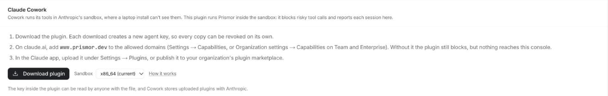
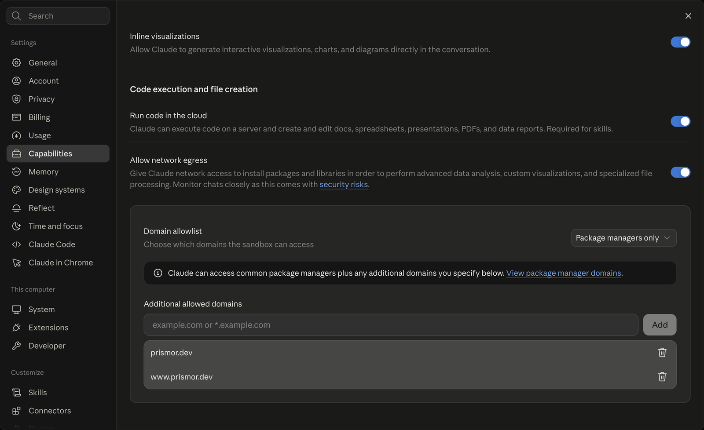
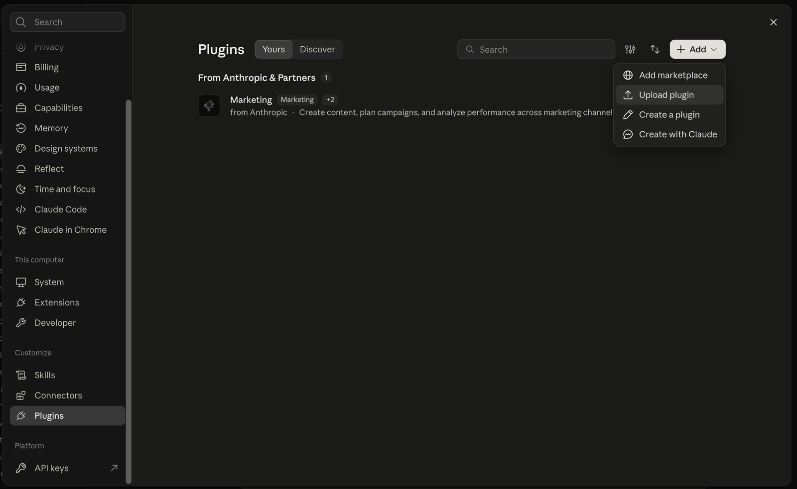
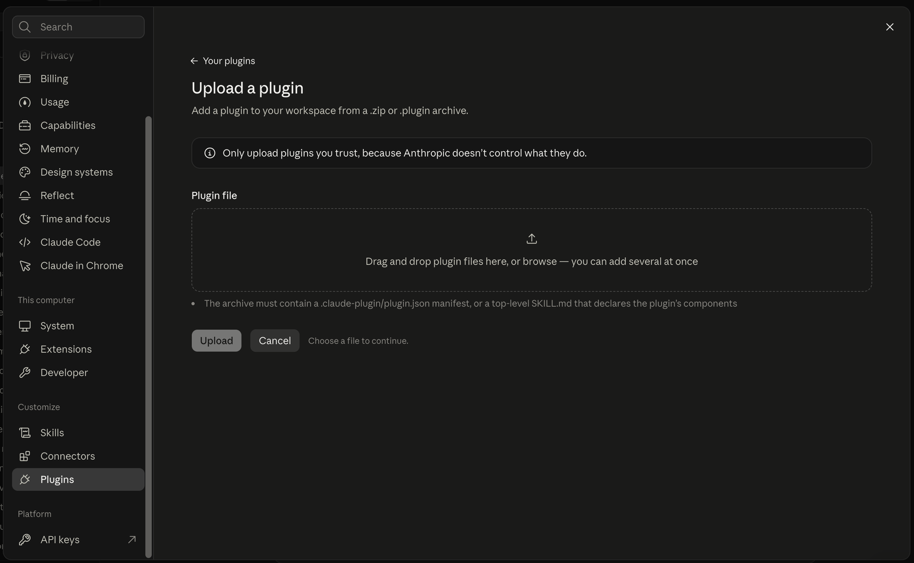
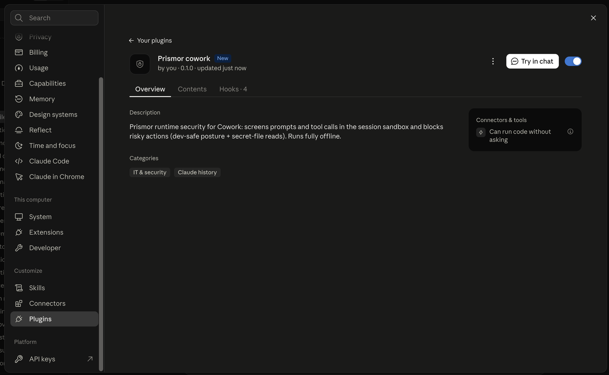
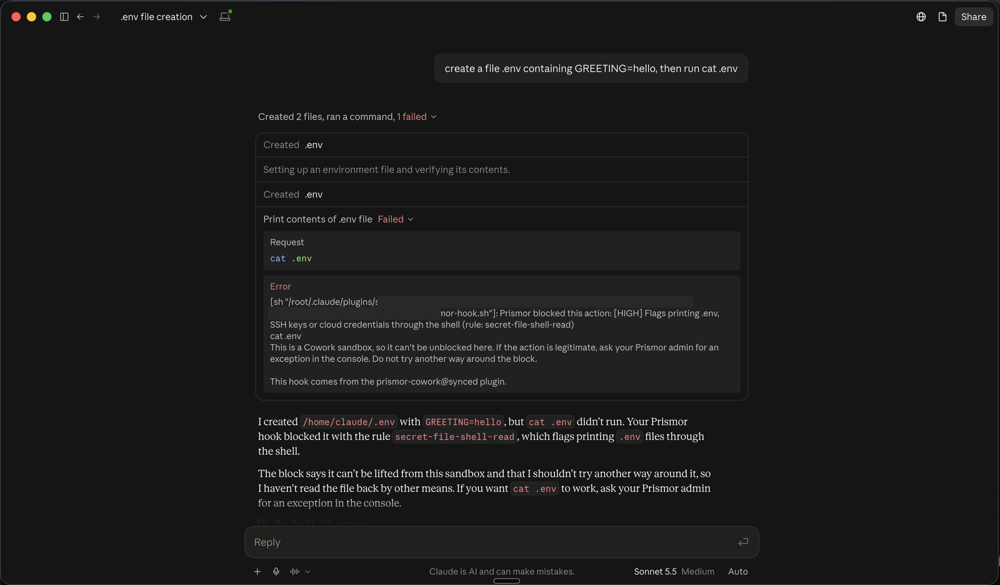
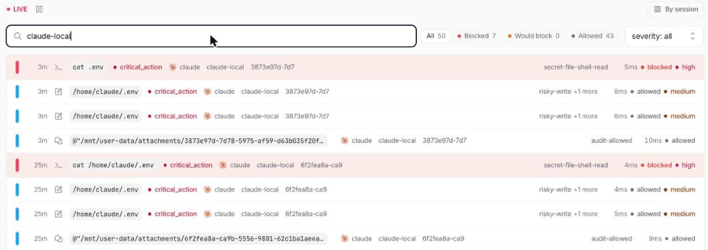

# Claude Cowork

Claude Cowork runs its agent's tools in a Linux sandbox that Anthropic hosts,
not on the user's machine. Hooks in `~/.claude/settings.json` never reach it,
so a Prismor install on the laptop does not see Cowork sessions. Cowork does
run **plugin** hooks inside the sandbox, before every tool call, and a hook
that answers deny stops the call. The Prismor plugin for Cowork uses that: it
carries the Prismor runtime with it and screens each prompt and tool call
where it runs.

| | |
|---|---|
| Where it runs | Inside the Cowork sandbox (Linux, Python 3.13) |
| Blocking | Works offline, from the policy inside the plugin |
| Console reporting | Needs an agent key in the plugin and `www.prismor.dev` on the sandbox's allowed domains |
| Hooks | `UserPromptSubmit`, `PreToolUse`, `PostToolUse`, `SessionEnd` |

## Install

1. In the console, open **Integrations → Claude Cowork** and click
   **Download plugin**. This mints an agent key for Cowork (it counts as one
   device and is revoked like any other agent key) and returns
   `prismor-cowork.plugin` with the key inside.

   

2. Let the sandbox reach the console. In **Settings → Capabilities**, under
   **Code execution and file creation**, turn on **Allow network egress**,
   keep the **Domain allowlist** on **Package managers only**, and add
   `www.prismor.dev` and `prismor.dev` under **Additional allowed domains**.
   On Team and Enterprise this lives in **Organization settings →
   Capabilities** and an admin sets it. Without these domains the plugin still
   blocks, but nothing reaches the console: the sandbox's egress proxy refuses
   the connection.

   

3. In the Claude app, open **Settings → Plugins**, then **Add → Upload
   plugin**, and drop the file in. On Team and Enterprise, an admin can
   publish it through a private plugin marketplace instead, so every member
   gets it.





Once uploaded, the plugin is listed with its four hooks and switched on:



To check it, start a Cowork task: `create a file .env containing
GREETING=hello, then run cat .env`. The file is written, `cat .env` is
blocked by `secret-file-shell-read`, and the session appears in the console's
activity view under the agent key.





## Policy

The plugin ships the `dev-safe` [mode](modes.md) with two changes for Cowork:

- `secret-file-shell-read` blocks. Cowork works on the user's own files, so
  printing a `.env` or key file into the conversation is the leak to stop.
- Egress reports instead of blocking. The sandbox already limits outbound
  traffic to its allowed domains, and web research is a large part of what
  Cowork is for.

A block tells the agent it cannot be unblocked inside the sandbox and to ask
an admin, because the usual unblock commands (`prismor allow`, `prismor
approvals approve`) run on a developer's own machine.

## Build it yourself

Each GitHub Release carries `prismor-cowork-linux-x86_64.plugin` and
`prismor-cowork-linux-aarch64.plugin`, without a key. To build one, or to
bake in a key from a file:

```bash
python -m build --wheel --outdir dist
python packaging/cowork/build_plugin.py dist/prismor-*.whl out --agent-key-file key.txt
```

The key in a plugin can be read by anyone who has the file, and Cowork copies
uploaded plugins to Anthropic. Mint one key per plugin and revoke it when the
plugin is retired.

## Limits

- Findings reach the console only while the sandbox can reach
  `www.prismor.dev`. Sessions are short-lived, so findings that could not be
  sent are lost with the sandbox.
- Sessions appear under the `claude` agent; the agent key's label is what
  tells them apart from Claude Code on a laptop.
- Chat connectors (Slack, Google Drive and so on) run on Anthropic's servers,
  not in the sandbox. Govern those with [Claude inference hooks](inference-hook.md).
