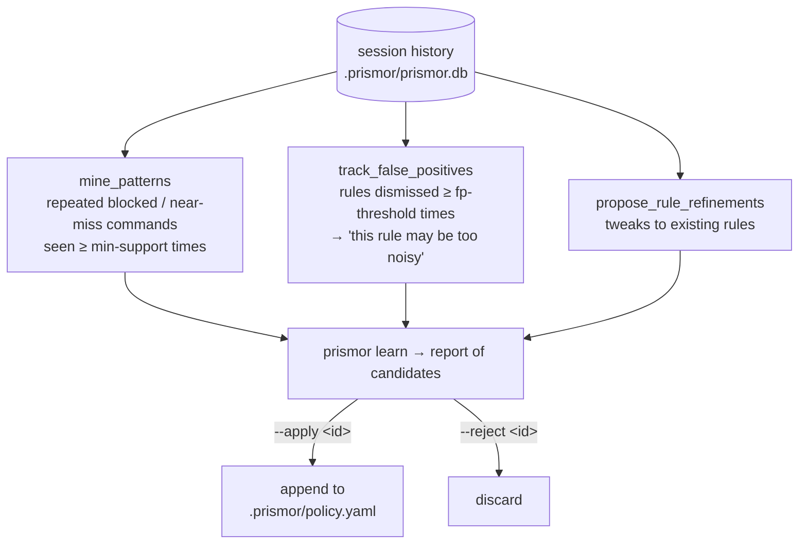

# Learning (Adaptive Rules)

Prismor logs every session. The learning engine mines that history to **propose
new rules, flag false positives, and catch evasion** — turning the patterns you
actually see into policy you can accept with one command. Nothing is applied
automatically: it surfaces candidates and you decide.

Implementation: [`prismor/runtime/learning.py`](../prismor/runtime/learning.py).

---

## How it works



Three signals feed the report:

| Signal | What it surfaces |
|---|---|
| **Pattern mining** | Commands that recur across sessions and look risky but aren't yet covered — proposed as new candidate rules with a confidence score and support count. |
| **False positives** | Existing rules you keep dismissing (in `observe` mode, a skip is recorded). Past a threshold, the rule is flagged as too noisy. |
| **Refinements** | Suggested adjustments to existing rules. |

There is also **evasion detection**: when a shell command *passes* but is
structurally similar to one a rule previously blocked, the dispatcher flags it as
a possible bypass attempt — catching `r''m -rf` style obfuscation of a known-bad
command.

Staged-execution detection blocks scripts downloaded earlier in the session,
including downloads saved through redirects or `tee`. It warns when a script's
artifact provenance records untrusted content, including content copied from a
tool response or inherited from another session. Ordinary agent-authored helper
scripts do not trigger this warning. The separate warning for transferring an
in-session file with `scp` or `rsync` is unchanged.

---

## Why a human stays in the loop

Auto-applying mined rules would let noise and one-off commands ossify into
policy. The learning engine instead proposes; you review confidence, support
count, and a sample before accepting. Accepted rules are appended to your
project's `.prismor/policy.yaml`, so they're version-controlled and
shareable like any other rule.

---

## Commands

```bash
# Run the full analysis and print a report
prismor learn
prismor learn --min-support 5      # require 5 occurrences before proposing
prismor learn --fp-threshold 10    # flag a rule after 10 dismissals
prismor learn --json               # machine-readable

# Review and act on candidates
prismor learn --candidates         # list pending candidate rules with ids
prismor learn --apply <id>         # accept → appends to project policy.yaml
prismor learn --reject <id>        # discard a candidate
```

| Flag | Default | Effect |
|---|---|---|
| `--min-support` | 3 | Minimum occurrences before a pattern becomes a candidate. |
| `--fp-threshold` | 5 | Dismissal count at which a rule is flagged as a false positive. |
| `--candidates` | — | List pending candidates instead of re-mining. |
| `--apply <id>` | — | Accept a candidate into `.prismor/policy.yaml`. |
| `--reject <id>` | — | Reject a candidate. |
| `--json` | — | Emit raw JSON. |

---

## A typical loop

1. Run agents for a while in `observe` or `enforce` mode — sessions accumulate.
2. `prismor learn` surfaces a recurring `psql … prod` command you keep stopping.
3. `prismor learn --candidates` shows it as candidate `#4` (confidence 80%, support 6).
4. `prismor learn --apply 4` appends the rule to your project policy.
5. `prismor policy show` confirms it's now active; commit the policy file.

After applying, validate and re-check:

```bash
prismor policy validate .prismor/policy.yaml
prismor policy show
```

---

## See also

- [Prismor](prismor-runtime.md) — the policy engine candidates are applied to
- [Dashboard](dashboard.md) — browse the session history learning draws from
- [CLI Reference](cli-reference.md) — all commands at a glance
