# MCP Hub: from server to governed endpoint

This guide walks through the console's **MCP Hub**, from adding an MCP server to
an agent calling it through a governed URL. It uses
[DeepWiki](https://mcp.deepwiki.com), a public server that needs no key, so
every step can be repeated as written.

By the end you will have:

1. a server in your registry, with gateway settings and tool rules,
2. a tool call tested from the console,
3. a hosted endpoint that an agent connects to with one command,
4. a switched-off tool that the agent can't see or call, with the blocked
   attempt in the activity log.

Hosted endpoints need a Team or Enterprise plan. Everything else on this page
also works with the local gateway on any plan. See
[MCP Gateway](mcp-gateway.md) for the CLI side.

## 1. Your registry

Open **MCP Hub** in the console. *Your registry* lists every MCP server your
organization has added. Each card shows the tool prefix agents see
(`cfdocs__*`), whether the server is remote (a URL) or local (a command), how
many tools it has, and which hosted endpoints serve it. The switch on a card
turns the whole server on or off for everyone.

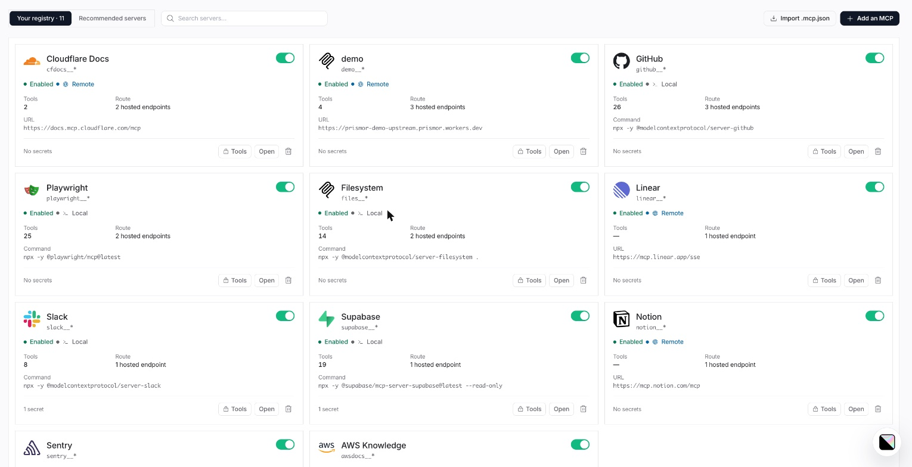

*Recommended servers* lists well-known servers to start from, and
*Import .mcp.json* adds the servers from an MCP config file you already have.

## 2. Add a server

Click **Add an MCP**. The wizard has five steps.

**General.** Name the server and give its source: a URL for a remote server, or
a command such as `npx -y @modelcontextprotocol/server-github` for a local one.
The tool prefix is filled in from the name; agents see each tool as
`<prefix>__<tool>`. Put any keys the server needs under *Secrets*, one
`KEY=value` per line. They are encrypted at rest and never shown again.

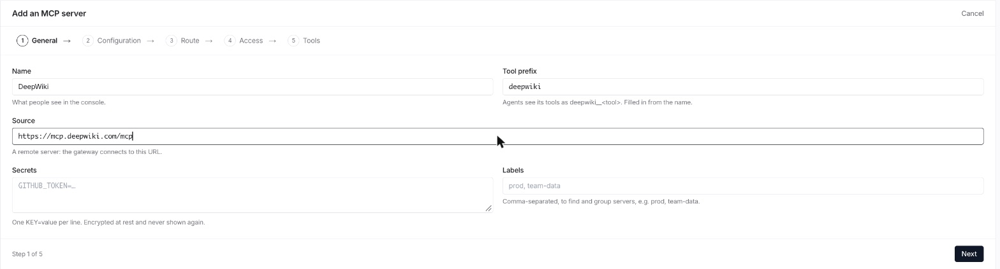

**Configuration.** How the gateway talks to the server. The defaults suit most
servers; [section 3](#3-the-server-page) covers each field.

**Route.** Which hosted endpoints should serve this server. Every local
gateway can run it regardless. You can skip this and attach endpoints later.

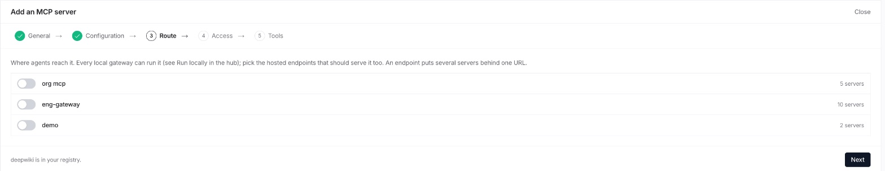

**Access.** *Everyone in the organization* makes the tools callable as soon as
you finish. *Nobody yet* adds the server switched off, so you can review its
tools first. *New tools start off* keeps any tool the server adds later
switched off until someone turns it on.

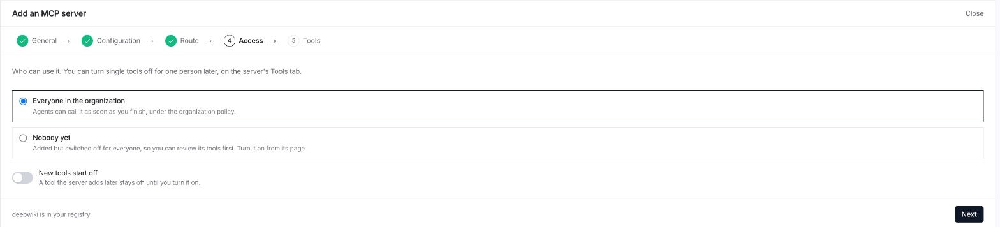

**Tools.** The server's tools, read from a live connection. Switch any off, or
rename them, before agents ever see them. Click **Finish**.

## 3. The server page

Finishing the wizard opens the server's page. *Overview* shows calls and blocks
over the last 30 days, and an *About* card with a copy button on each value:
the name, the name agents see (`deepwiki__<tool>`), and the URL or command.

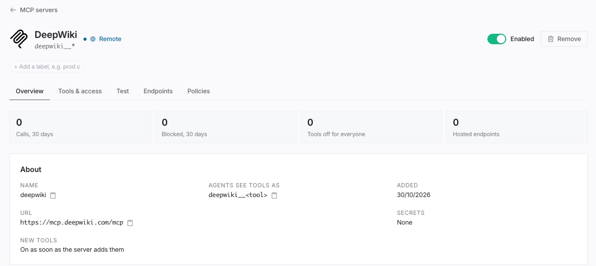

Below it, *Gateway settings* tune how the gateway talks to this server:

| Setting | What it does |
|---|---|
| Cache the tool list | Reuse the tool list for this many seconds instead of asking the server each time. Dropped as soon as the server says its tools changed. |
| Call timeout | How long one tool call may take before the gateway gives up. 300 seconds by default. |
| Max body size | A call whose arguments, or a reply, is bigger than this fails with a clear error. |
| Log payloads | Keep each call's arguments and result, after secrets are redacted, in the activity log. Off keeps only who called what and the verdict. |
| Forward client headers | Headers copied from the caller's request to the server on hosted endpoints. `Authorization`, `Cookie`, `Host`, `Content-Length` and `Mcp-Session-Id` are never forwarded. |
| Managed session | The gateway keeps the server's MCP session and starts a new one if it expires. Turn it off for servers that reject sessions. |
| AWS SigV4 signing | Sign every request with AWS credentials, for MCP servers behind API Gateway, Lambda URLs or Bedrock AgentCore. |

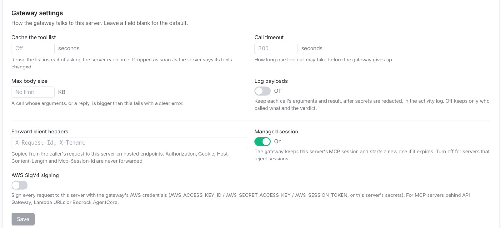

## 4. Tools and access

The *Tools & access* tab controls what agents can use. Changes reach every
hosted endpoint and local gateway within about 30 seconds.

- **Switch a tool off** and agents stop seeing it in their tool list. A call to
  it anyway is blocked and logged. *Everyone* applies to the whole
  organization; *One person* applies to a single user's calls.
- **Turn off by pattern**: `*delete*` switches off every tool whose name
  matches.
- **Rename** a tool to change the name or description agents see. Policy rules
  and switches keep using the server's own name, so a rename never gets a tool
  past a rule.

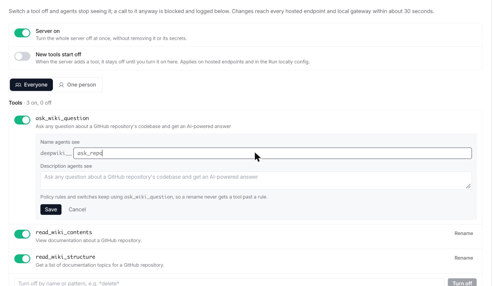

## 5. Test a tool

The *Test* tab calls one tool on the server right now, from Prismor, with the
secrets stored for it. Pick a tool; the arguments box starts with the tool's
required fields. Click **Run** to see the result and how long it took. Test
calls skip the gateway's policy, since they check that the server works, and
each one is recorded in the audit log. Results larger than 64 KB are cut, and
the panel says so.

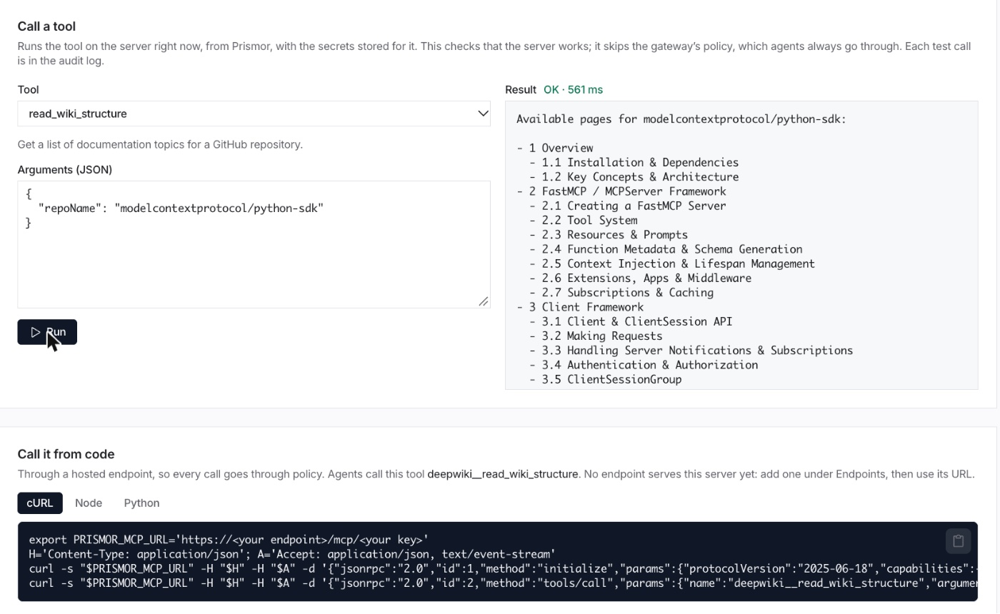

*Call it from code* gives the same call as cURL, Node and Python snippets that
go through a hosted endpoint, so they run under policy like any agent.

## 6. Create a hosted endpoint

A hosted endpoint is one MCP URL, run by Prismor, that serves the servers you
pick. Nothing is installed on the machine that uses it, and server secrets stay
on Prismor's side.

In MCP Hub, scroll to *Hosted endpoints* and click **Spin up MCP instance**.

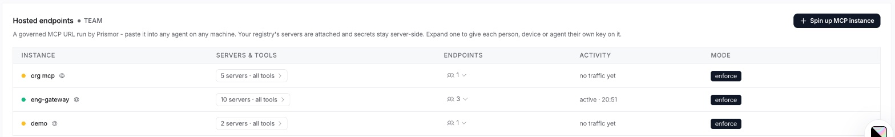

Give it a label, pick its servers, and optionally bind it to one person so
their own tool rules apply. Then click **Create**.

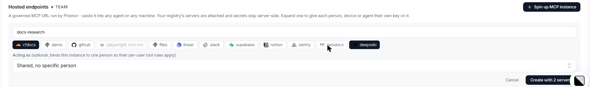

The URL is shown once, as a Claude Code command or an `.mcp.json` block. The
key in the URL is the credential, so store it like a secret.

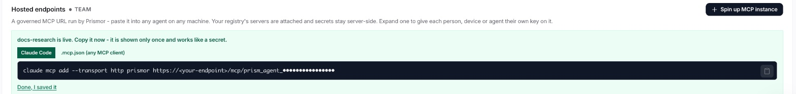

Connect an agent:

```bash
claude mcp add --transport http prismor https://<your-endpoint>/mcp/<key>
```

Any other MCP client takes the same URL:

```json
{
  "mcpServers": {
    "prismor": { "type": "http", "url": "https://<your-endpoint>/mcp/<key>" }
  }
}
```

The agent now sees one connector with every tool from the endpoint's servers:
`cfdocs__search_cloudflare_documentation`, `deepwiki__ask_wiki_question`, and
so on. To give each person, device or agent their own key on the same endpoint,
expand it in the table. Their calls are then attributed to them, and each key
can be revoked on its own.

## 7. Watch it work

Back on the server page, switch **read_wiki_contents** off for everyone. Within
30 seconds the agent's tool list drops it. If the agent calls it anyway, the
gateway blocks the call before it reaches DeepWiki and returns the reason as
the tool result:

```
Blocked by Prismor: [high] [agent:guide] Tool 'mcp__deepwiki__read_wiki_contents' is denied (org scope) (rule: org-tool-deny)
```

The *Tools & access* tab now shows each tool's calls in the last 30 days, and
*Recent activity* lists every call, with the blocked one marked. *All activity*
opens the full log in Activity.

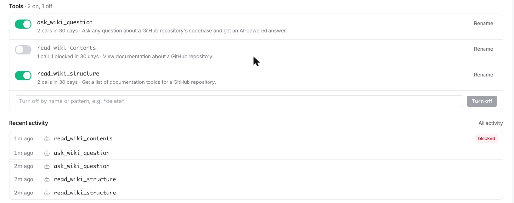

Every call through an endpoint is also checked against your organization's
policy, and every result is screened before the model sees it: secrets are
masked, and a flagged result (a prompt injection, say) is withheld and replaced
with the reason.

## 8. Resources and prompts

The gateway passes MCP resources and prompts through as well as tools.
Resources keep their URIs; prompts are named `<prefix>__<prompt>`, like tools.
Reading a resource or getting a prompt goes through the same policy as a tool
call, so switching a server off covers all three, and what comes back is
screened the same way.

## Turning things off

- **A tool**: its switch on *Tools & access*.
- **A server**: the *Enabled* switch on its page or card. Its secrets and
  settings are kept.
- **An endpoint, or one person's key**: revoke it in the *Hosted endpoints*
  table. Clients get `403 invalid or revoked instance key` within 30 seconds.
- **Observe instead of block**: each endpoint's *Mode* switches between
  enforce (the default) and observe, which logs violations without blocking.

## Run it locally instead

Every server page ends with a *Run it through the gateway* block: the entry for
`~/.prismor/mcp-gateway.json`. Run `prismor mcp-gateway install` and your local
agents use the same registry, tool switches and policy, with secrets kept on
your machine. Servers that drive a browser, such as Playwright, only run
locally. See [MCP Gateway](mcp-gateway.md).
